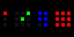

# Tix Clock Square LEDs



Shows the time as four blocks of square LEDs, left to right:

| Block | Size | Color | Shows |
| --- | --- | --- | --- |
| 1 | 1×3 | red | hours, tens |
| 2 | 3×3 | green | hours, ones |
| 3 | 2×3 | blue | minutes, tens |
| 4 | 3×3 | red | minutes, ones |

Count the lit squares in each block to read the digit. Which squares are lit is random and
changes on a set interval; only the count matters.

On 64×32 each LED is a 5×5 cell (a 3×3 lit center with a 1-pixel black border), with a
5-pixel gap between blocks. That makes a 60×15 grid, centered on the display. It's doubled on
128×64 and centered on 64×64.

## Settings

- **Change pattern every**: 1 second (default), 4 seconds or 1 minute.
- **Color scheme**: red, green, blue, red (default, as in the table above); blue, red,
  yellow, green; or **Custom**. Choosing Custom shows a color picker for each block (a
  `schema.Generated` field), starting from the default colors. The pickers are only used
  while Custom is selected, so switching to another scheme always gives exactly its colors.
- **Show unlit LEDs** (on by default): draws unlit LEDs as very dark grey (`#111111`)
  squares instead of leaving them black, so the whole grid is visible.
- **24-hour clock**: hours as 0–23 instead of 1–12.
- **Display lag (seconds)**: Tronbyt sends an app's image while the previous one is still on
  screen, so the clock can start out behind by that long. This shifts the time forward to
  make up for it. When the app is pinned, use its display time (e.g. 60).

## Preview images

They show 12:59, so every block has lit squares. The clock always uses the current time, so
the commands below shift it with `offset_secs` to start right at 12:59:00 (the animation
covers the next 59 seconds). Each one waits for the start of a second first, so the whole
animation stays within 12:59. From this folder:

```
at1259() { python3 -c '
import datetime as d, time
time.sleep(1.02 - time.time() % 1)
n = d.datetime.now().replace(microsecond=0)
t = n.replace(hour=12, minute=59, second=0)
t = t if t > n else t + d.timedelta(days=1)
print(int((t - n).total_seconds()))'; }
pixlet render -z 9 tixclock_square_leds.star offset_secs=$(at1259) -o tixclocksquareleds.webp
pixlet render -2 -z 9 tixclock_square_leds.star offset_secs=$(at1259) -o tixclocksquareleds@2x.webp
pixlet render -w 64 -t 64 -z 9 tixclock_square_leds.star offset_secs=$(at1259) -o tixclocksquareleds@64x64.webp
```
